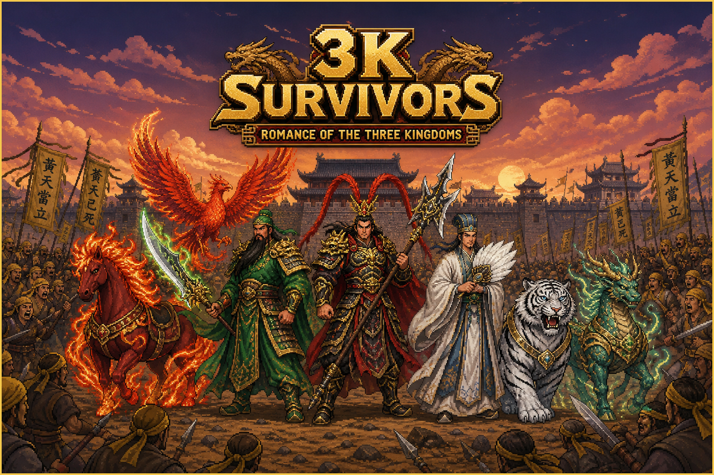

# 3K Survivors



A mobile-first, Three Kingdoms-themed action survival game inspired by *Vampire Survivors*, built with **PixiJS 8** and **Vite**. Designed to sustain **60 FPS with 300+ active enemies** at mobile viewports (`390×844` portrait and `844×390` landscape) with zero external art dependencies.

---

## Key Features

- **12 Three Kingdoms Warriors Across 2 Roster Pages (Universal LPC `64×64` Sprite Sheets):** Switch between **Roster 1 (`Shu / Han Heroes`)** (**Guan Yu**, **Zhang Fei**, **Zhao Yun**, **Zhuge Liang**, **Lu Bu**, **Sun Shangxiang**) and **Roster 2 (`Wei / Wu / Legends Warlords`)** (**Cao Cao**, **Zhou Yu**, **Diaochan**, **Ma Chao**, **Sima Yi**, **Meng Huo**)—each with custom Universal LPC 4-direction walk & attack animations and signature **Musou Ultimates**.
- **3 Pre-Game Starting Perks (War Decrees):** Choose between **Vanguard Edict** (`+20% DMG, +10% Area`), **Imperial Aegis** (`+35 Max HP, +2 Armor`), or **Windfoot Mandate** (`+15% SPD, -10% CD, +25% XP`) before deploying.
- **10 Three Kingdoms Campaigns × 10 Levels × 5 Waves (`100` Stages), New-Campaign Loadout Reset & Auto-Save:** Progress through **10 Campaigns** (**Outskirts**, **Hulao Pass**, **Guandu**, **Changban**, **Red Cliffs**, **Tong Pass**, **Hefei**, **Fan Castle**, **Yiling**, **Wuzhang** — **10 levels per campaign**, 5 waves per level). Whenever you begin a **new Campaign (`X-1`)**, all weapons, passive skills, and pets reset back to your hero's starting Level 1 loadout. Weapon, Armor, and Pet upgrades trigger **only when you eliminate all enemies of a wave**; Wave 5 spawns the stage **Boss**, and killing all enemies + the Boss completes the level, **auto-saves your Campaign Checkpoint (`localStorage`)**, and opens the **10-Campaign × 10-Level Checkpoint Map Screen**.
- **Startup Saved Checkpoint Prompt (`Resume Session` vs `Start New Game` Clearing Save) & `300–1000` Final Wave Horde Surge:** When visiting the game, if a saved checkpoint exists in `localStorage`, a **Saved Checkpoint Found** screen lets you either **Resume Last Save Session** (restoring your hero, perk, campaign/stage, wave, weapons, passives, and pets) or **Start New Game (Choose Character)** (which clears the saved checkpoint in `localStorage` and resets progress). On the **Last Wave (`Wave 5/5`)** of every stage, the game always unleashes a massive **`300–1000` enemy horde surge** alongside the Stage Boss.
- **Summon Pet System (4 Mythic Companions, Lv 1–5):** Fight alongside **Red Hare** (*Flame Warhorse* trampling charge), **Vermilion Bird** (*Fire Phoenix* explosive fireballs), **White Tiger** (*Frost Fang* pouncing claw slashes), and **Jade Qilin** (*Celestial Stag* lightning strikes & periodic healing)—starting with your warrior's bonded companion and summoning/upgrading up to all 4 pets simultaneously via Level-Up cards.
- **Escalating Wave Hordes, Overhead Horde Health Bars, Balanced Warlord Bosses, Siege Catapults & Aerial Bullet-Rain Bird Flocks:** Each wave (`1..5`) escalates horde size, spawn frequency, batch size, and enemy HP/DMG/Speed, with every on-screen enemy displaying an overhead **Health Bar** (`green → amber → red`). Waves 2–5 deploy wheeled **Siege Catapults** that lob flaming explosive boulders and **V-formation Feather-Storm Bird Flocks** (*Feather-Storm Hawks*) that fly overhead unleashing 5-way **Bullet Rain** feather-dart volleys. Picking up a battlefield **Bomb** triggers a **`420px × areaMul` Mega Kaboom** (`185 × dmgMul` wave-scaled blast with dual inner/outer fireball rings). Every Campaign and Level features distinct **faction armor tints**, **enemy squad rosters** (including **Imperial Halberdiers**), and **ranged weapon styles**. Stage Bosses feature balanced **15% Warlord Armor Mitigation**, a **30% Max-HP single-hit cap**, and a **50% HP Enrage Phase** (`+14% Speed`, `+12% DMG`, crimson aura, and 2 Imperial Halberdier bodyguards).
- **Rare Colossal Kaiju Godzilla Titan Boss (`2–5 Min` Endurance & Bomb Immune), Rare Golden Egg, 4-Frame SD Ultra Battle Ultraman & Rarest-Moment Cosmic UFO Saucer:** Waves 4–5 have a rare (`7%`) chance to spawn a **Colossal Universal LPC Kaiju Godzilla Titan (`kaiju`, `12,000` base HP, `3.25×` scale, `68×5px` cyan Titan Health Bar)** that is **100% Immune to Bombs (`BOMB IMMUNE!`)** and armored with **`85%` Titan Scales Defence + `0.045%` Max-HP per-tick cap** (requiring **`2–5 minutes` (`178s–300s`)** of sustained player attacks to kill unless **Ultraman** is summoned), while its **Seismic Stomp (`AoE`)** and **3-Zone Atomic Breath (`AoE`)** deal **`35%–50%` of Player Max HP per hit**. During a Kaiju fight, a rare (`18%–20%`, max 1 per encounter) **Golden Egg (`golden_egg`)** can drop—picking it up summons the **4-Frame SD Ultra Battle Ultraman/Ultraseven (`2.85×` scale)** for **`10` seconds** whose Specium Ray / Wide Shot bypasses Godzilla's scales and deals **`30%–50%` of Kaiju Max HP per hit**. In the **rarest moments (`3%`)**, a **Cosmic UFO Flying Saucer (`ufo`, `2.15×` scale with alien pilot in glass dome & 8 spinning neon rim lights)** flies overhead calling down targeted **Cosmic Lightning Strikes** that remove **`80%` of Player Max HP** (and **`30%–50%` of Kaiju/Titan Max HP**) on hit; the UFO is **100% Immune to all weapon damage except Arrows (`0.5%` Max HP per Arrow) and Battlefield Bombs**!
- **CraftPix & itch.io Style Top-Down Pixel Art Props & Companions:** Trees, conifers, flowering bushes, boulders, war banners + barrels, medieval village houses, stone watchtowers with ladders, fortress gatehouses, chests, and 4-frame animated companions (`assets/sprites/terrain/props.png`, `assets/sprites/pets/pets.png`) crafted with crisp `1px` dark pixel outlines and 3-tone shading inspired by [CraftPix Freebies](https://craftpix.net/freebies/) and [itch.io Free Top-Down Assets](https://itch.io/game-assets/free).
- **Imperial Armory Gold Shop (5 Permanent Upgrades):** Spend Gold earned from bosses, chests, and wave clears in the **Imperial Armory (`ARMORY`)** on 5 permanent upgrades (**Imperial Forge** `+12% DMG/lv`, **Dragon Scale Armor** `+1 Armor & +20 HP/lv`, **Wind-Chaser Boots** `+7% SPD & -5% CD/lv`, **Imperial Treasury** `+25% Gold/XP & +30px Magnet/lv`, and **Celestial Mandate** `+6% Egg/Mount Luck & +1 Phoenix Revive`).
- **Hero Musou Rage Gauge & Active Ultimate Skill (`Space`/`R` or `★ MUSOU ★` Button):** Every kill charges your hero's **Musou Rage Gauge (`0–100%`)**. At `100%`, press `Space`/`R` or tap the glowing **`★ MUSOU [R] ★`** button to unleash your warrior's signature **Musou Ultimate** (**Green Dragon Tsunami**, **Roar of Changban Bridge**, **Seven-Star Dragon Storm**, **Eight-Trigram Heaven Fire**, **Demon God Sky-Piercer**, or **Crimson Lotus Barrage**) with `3.5s` invulnerability.
- **Mount Riding System (`20s` Red Hare Cavalry Charge):** Pick up a **War Saddle (`saddle.png`)** on the battlefield to mount **Red Hare** for `20s`, gaining **`+55%` Movement Speed**, **35% Damage Reduction**, and **Cavalry Trample Damage + Knockback** by riding directly through enemy hordes.
- **Interactive Battlefield Hazards (Explosive Oil Barrels, Capturable Ballista Turrets & Sacred War Shrines):** Strike **Red Explosive Oil Barrels (`barrel.png`)** to detonate a `165px` chain-reaction fireball; stand inside a **Capturable Ballista Turret** ring for `1.2s` to claim an automated rapid-fire siege turret for `25s`; or claim a **Sacred War Shrine** to receive a random war blessing (`+35 HP + 50% Musou` or `20s Mount + +25G`).
- **3-Headed Golden Dragon `King Ghidorah` Titan Boss & 3-Guardian Golden Egg Summon:** Kaiju encounters can spawn the colossal **3-Headed Golden Dragon `KING GHIDORAH` (`13,500` base HP, 5-way Golden Gravity Lightning Storm)** alongside **Kaiju Godzilla**. Collecting a **Golden Egg** summons one of **3 Colossal Guardians** (**Ultraman**, **Colossal Mecha-General**, or **Celestial Golden Dragon**).
- **Endless Boss Rush / Survival Arena Mode:** Toggle **`MODE: CAMPAIGN` ↔ `ENDLESS`** on the Main Menu to enter **Endless Survival Arena**, featuring unbounded waves (`Wave 1 → ∞`), Warlord Bosses every 3rd wave, `300–1000` Horde Surges every 5th wave, and persistent **`BEST WAVE` / `BEST KILLS`** high-score tracking in `localStorage`.
- **Sworn Brotherhood / Dual-General Assist (`SWORN_BONDS`):** Every warrior deploys with a **Sworn Partner General** (e.g., *Guan Yu + Zhang Fei: Peach Garden Oath*, *Cao Cao + Sima Yi: Heaven Decree of Wei*, *Zhou Yu + Sun Shangxiang: Red Cliffs Armada*, *Lu Bu + Diaochan: Crimson Moon Eclipse*) who periodically leaps onto the battlefield (and joins every Musou Ultimate) to unleash a **Dual-General Combo Strike**.
- **Illustrated Bestiary & Imperial Seals Relic Hall (`CODEX`):** Open **`CODEX (6/6)`** on the Main Menu to inspect the **Bestiary** (animated sprites, stats, roles, and kill counts for Infantry, Cavalry, Catapults, Hawks, Warlords, **Kaiju Godzilla**, **King Ghidorah**, and **Cosmic UFO**) and **6 Imperial Seals (`CODEX_RELICS`)** granting permanent passive combat bonuses (`+10% DMG`, `+12% Area`, `+25 HP & +1 Armor`, `-8% CD`, `+25% Partner Assist DMG`, `+20% Gold & XP`).
- **Mythic Tier-3 Weapon Fusions (`Lv 8 + Lv 8` Synergy):** Reaching Max Level (`Lv 8`) on two weapons awakens a **Mythic Weapon Fusion** (**Azure Dragon Heaven-Splitter**, **Eight-Trigram Cosmos Array**, or **Infernal Sky-Piercer Cataclysm**), granting `+65%` bonus damage and periodic 8-way Azure Dragon Supernovas.
- **Chibi Naval Warship Deck & Blazing Yangtze River Hazard Kills (`naval_river`) + Mid-Wave Dynamic Events:** Knocking enemies into **Blazing Yangtze River Channels** triggers instant **`🌊 CHIBI RIVER HAZARD KILL!`** detonations, while dynamic mid-wave events unleash **Golden Supply Caravans** (`+35G` & Chest on destruction), **Blood Moon Eclipses** (`2×` Gold/XP & `+20%` Attack Speed), and **Warlord Duel Rings** (`+40%` Damage & `1.5×` Musou Charge inside the ring).
- **8 Seamless `256×256` OpenAI `media-gen` Pixel-Art Terrain Biomes (`TERRAIN_BIOME_SPECS`):** Stages across the 10 Campaigns feature 8 distinct `256×256` 16-bit pixel-art terrain tilesets generated via the `media-generation` OpenAI provider (`gpt-image-2` in `assets/sprites/terrain/{grassland,fortress,scorched,warship,snowfield,flooded,magma,star_altar}.png`), each with tactical combat modifiers: **Peach Blossom Grasslands** (`+1 HP/s` Regen), **Hulao Fortress Flagstone** (`+1` Armor), **Guandu Scorched Trenches** (`+12%` DMG), **Chibi Chained Warship Deck** (`+15%` Area), **Tong Pass Frozen Icefield** (`+12%` Move Speed & `-10%` Enemy Speed), **Fan Castle Flooded Causeway** (`-14%` Enemy Speed), **Yiling Magma Fissures** (`+18%` DMG), and **Wuzhang Obsidian Star-Altar** (`-10%` Cooldown & `+15%` XP).
- **16 Weapons with `32×32` OpenAI `media-gen` Pixel-Art Icons & Sprites (`WEAPONS` & `EVOLUTIONS`):** All 16 Three Kingdoms weapons feature custom `32×32` OpenAI-generated pixel-art icons (`assets/sprites/ui/icons.png`), `64×64` **Wooden Ox Automaton** battlefield sprites (`wooden_ox_sprite.png`), and `96×96` **Molten Meteor Boulder & Volcanic Geyser** disaster sprites (`meteor_boulder.png`, `volcano_geyser.png`, `meteor_crater.png`, `fire_cyclone.png`): **Zhuge Repeating Crossbow** (*Ten-Thousand Bolt Tempest*), **Fire Oil Flask** (*Chibi Hellfire Sea*), **Meteor Hammer Chain** (*Soul-Seizing Dragon Chain*), **Wooden Ox Automaton** (*Juggernaut Flame Ox*), **Five-Thunder Talisman** (*Nine-Skies Thunder Wrath*), **Iron Lotus Caltrops** (*Eight-Gates Iron Lotus*), **Imperial War Drum** (*Earth-Shaker Thunder Drums*), and **Shadow Clone Talisman** (*Phantom Army of One*).
- **6 Random Natural Cataclysm Disasters (`DISASTER_SPECS` — Damages Player & Enemies):** Every stage can trigger telegraphed environmental cataclysms (`1.05s–1.8s` shrinking bullseye warning circles before impact) that deal heavy collateral damage to enemy hordes **and hurt the player (`14%–30%` Max HP) if not dodged**: **Volcanic Magma Eruption** (molten magma bombs + lingering `3.5s` lava pools that burn both player & foes), **Starfall Meteor Crash** (`22%–30%` Player Max HP + `185` AoE enemy crater blast), **Blizzard Hailstorm Barrage** (`14%–20%` Player Max HP + `-35%` **Frostbite Move Speed Slow** for `2.5s`), **Heaven's Wrath Lightning Strikes** (`20%–26%` Player Max HP sky-splitting thunderbolts), **Tectonic Earthquake Fissures** (`18%–24%` Player Max HP fault-line eruptions), and **Infernal Fire Cyclone** (roaming blazing fire vortex that spirals across the battlefield for `7.5s`).
- **Defensive Rotating Orbit Weapons (`flying_blades`, `bagua_shields`):** Choose **Rotating Flying Blades** (*evolves into Celestial Sword Wheel*) or **Eight-Trigram Shields** (*evolves into Imperial Aegis Ring*) on Level-Up to surround your warrior with `3–8` continuously orbiting blades/shields that slice/bash nearby enemies and **deflect incoming enemy projectiles**.
- **Weapon Progression (Lv 1–8), Mastered Skills (Lv 5) & Max-Level Awakened Specials:** Every weapon level scales damage (`+15%/lv`), area (`+8%/lv`), cooldown (`-5%/lv`), projectile/target count, and pierce. Reaching **Max Level (`Lv 8`)** automatically awakens the weapon's ultimate evolution with unique visual effects & special bonus damage (**Dragon Slayer** twin cross-slashes + 3 piercing dragon-flame waves, **Iron Pike** 3-prong trident + spear-tip explosion, **Sky Halberd** dual whirlwinds + 4 cardinal explosions, **Storm Bow / Gale Fan / Twin Dragons** exploding elemental projectiles, **Celestial Sword Wheel** 12-point dual rings + 6 radial sword-beams, **Imperial Aegis Ring** sacred repulsion shockwaves). Reaching **Max Level (`Lv 5`)** on any Passive Skill or Pet also awakens a pulsing **Mastered Aura Ring** and periodic special AoE attacks.
- **Vampire Survivors-Style HUD & Modals:** Safe-area-aware top HUD with a centered **12-slot weapon & passive loadout bar**, pixel-art icon Level-Up cards with stat deltas, and a tactical Game-Over summary card.
- **Four Seasons Map System, Three Kingdoms Buildings & Dynamic Weather:** A `10×4` seasonal prop & building atlas (**Spring Blossom** cherry-blossom canopies & `+1.5 HP/s` regen, **Summer Solstice** sunlit foliage & `+12% DMG / -8% CD`, **Autumn Harvest** fiery maple canopies & `+20% XP`, and **Winter Frost** snow-capped houses/castles/trees & `-12% Enemy Speed`), 4 solid building types (**Village Houses**, **Archer Watchtowers**, **Fortress Castle Keeps**, **War Pavilion Tents**), and a 6-mode **Stage Weather System** (`Breeze`, `Rain`, `Thunderstorm`, `Sandstorm`, `Embers`, `Snow`).
- **Multi-Frame Pixel-Art VFX (`scenario-pixel-vfx` — `13` Sprite Sheets):** 13 multi-frame, hard-banded pixel-art VFX sprite sheets (`explosion` 12f, `slash` 8f, `thrust` 8f, `whirlwind` 8f, `hit` 6f, `heal` 10f, `levelup` 12f, plus the **6 Natural Cataclysm Disaster sheets**: `volcano` 12f, `meteor` 12f, `hailstorm` 10f, `lightning` 10f, `earthquake` 12f, and looping `fire-tornado` 12f in `assets/sprites/vfx/`) rendered deterministically via `scripts/generate_vfx.mjs` and animated at 60 FPS.
- **ElevenLabs Per-Map BGM (`music_v2_5`) & Combat SFX:** 3 bespoke Three Kingdoms instrumental campaign map BGM tracks (`assets/bgm/{outskirts,hulao,redcliffs}.mp3` generated via `client.music.compose`) plus 12 combat & reward sound effects (`assets/sfx/*` generated via `client.textToSoundEffects.convert`), with automatic map track switching and a persistent `localStorage` Mute Toggle (`M` key or on-screen `SFX` button).
- **Locked 60 FPS Horde Engine:** Batched `ParticleContainer` enemy rendering, object pooling (`enemyPool`, `projPool`, `gemPool`, `hitPool`, `slashPool`, `textPool`), `SpatialHash` collision queries, and viewport-sized terrain tiling.

---

## Quick Start

### Prerequisites
- **Node.js** `>= 18`
- **Python 3 + Pillow (`PIL`)** *(optional, only required when regenerating pixel-art sprite sheets)*

### Install & Run
```bash
# Install dependencies
npm install

# Start Vite development server (http://127.0.0.1:5173/)
npm run dev

# Build static production bundle into dist/
npm run build

# Preview production build
npm run preview
```

### Regenerating Pixel-Art & SFX Assets
All sprites (`assets/sprites/`) and combat/UI audio (`assets/sfx/`) are deterministically generated:
```bash
python3 scripts/generate_sprites.py
python3 scripts/generate_lpc_sprites.py
node scripts/generate_vfx.mjs
python3 scripts/generate_sfx.py
npm run sfx:elevenlabs
npm run bgm:elevenlabs
```

---

## Documentation (`docs/`)

Development progress, architecture, combat formulas, and upcoming milestones are tracked in [`docs/`](./docs/) and [`progress.html`](./progress.html):

- **[`docs/PROGRESS.md`](./docs/PROGRESS.md)** — Milestone tracker, 15/15 piece verification matrix, and timestamped engineering log.
- **[`docs/ARCHITECTURE.md`](./docs/ARCHITECTURE.md)** — Runtime architecture, rendering layers, object pools, spatial hashing, and 60 FPS optimization breakdown.
- **[`docs/COMBAT_MATH.md`](./docs/COMBAT_MATH.md)** — Complete reference for Hero stats, Starting Perks, Weapon Lv 1–8 formulas, Evolution pairings, and Passive compounding.
- **[`docs/ROADMAP.md`](./docs/ROADMAP.md)** — Prioritized backlog for upcoming phases (Persistent Gold & Camp Upgrades, `node:test` Suite, WebAudio SFX, Wave Events).
- **[`progress.html`](./progress.html)** — Auto-refreshing HTML status dashboard.

---

## Project Structure

```text
3k-survivors/
├── assets/
│   ├── sfx/                 # 14 bundled CC0 uisfx (.ogg) & earshot physical combat (.wav) SFX
│   └── sprites/             # Generated pixel-art PNG sheets (heroes, enemies, terrain, effects, UI icons)
├── docs/                    # Engineering & development progress documentation
│   ├── ARCHITECTURE.md
│   ├── COMBAT_MATH.md
│   ├── PROGRESS.md
│   └── ROADMAP.md
├── scripts/
│   ├── deploy-pages.sh      # GitHub Pages (gh-pages) deployment script
│   ├── generate_sfx.py      # Deterministic combat WAV synthesizer + uisfx bundler
│   └── generate_sprites.py  # Deterministic pixel-art asset generator
├── src/
│   ├── main.js              # PixiJS 8 Application bootstrap (0.75x resolution, high-performance)
│   ├── audio.js             # WebAudio SoundManager (uisfx arcade + decoded AudioBuffers + mute state)
│   ├── game.js              # Core Game loop, UI modals, HUD, input, combat, and rendering
│   ├── data.js              # Heroes, Starting Perks, Weapons, Evolutions, Passives, Enemies
│   ├── sprites.js           # Texture loader and frame slicer (nearest-neighbor filtering)
│   ├── spatial.js           # 2D SpatialHash grid for O(1) neighborhood collision queries
│   └── utils.js             # Math helpers and generic object Pool
├── tests/                   # Playwright profiling and smoke scripts
├── index.html               # Mobile viewport shell + CSS radial-gradient vignette overlay
├── progress.html            # Auto-refreshing development status dashboard
└── vite.config.js           # Vite build configuration
```
