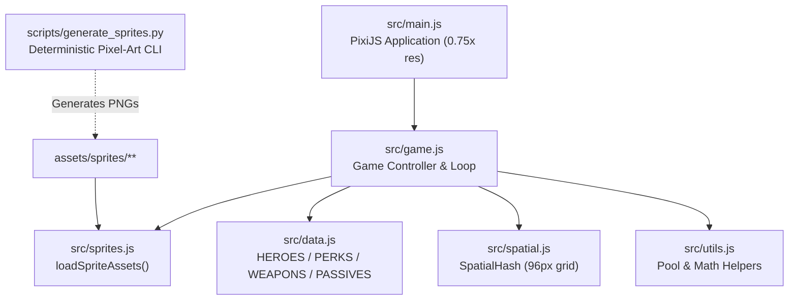

# Architecture & Performance Guide (`docs/ARCHITECTURE.md`)

## 1. Runtime Overview

`3K Survivors` is a 100% client-side browser application built with **PixiJS 8** and bundled with **Vite**.



### Module Responsibilities

| File | Environment | Responsibility |
|---|---|---|
| `src/main.js` | Browser | Initializes `Application` (`resolution: 0.75`, `antialias: false`, `powerPreference: 'high-performance'`), mounts canvas, calls `await game.start()`. |
| `src/game.js` | Browser | Owns game state (`menu`, `playing`, `levelup`, `gameover`), scene containers, object pools, input handlers, simulation loop, and UI modals. |
| `src/sprites.js` | Browser | Loads PNG sprite sheets via `Assets.load()`, applies `nearest` scale mode, and slices directional walk/attack frames, enemy frames, and `16×16` UI icons. |
| `src/data.js` | Browser / Node | Pure data definitions for `HEROES`, `STARTING_PERKS`, `WEAPONS`, `EVOLUTIONS`, `PASSIVES`, `ENEMY_TYPES`, and `LEVEL_XP`. |
| `src/spatial.js` | Browser / Node | `SpatialHash` grid (`cell = 96`) for fast neighborhood lookups during projectile collision and melee/ranged target acquisition. |
| `src/utils.js` | Browser / Node | Math helpers (`clamp`, `dist2`, `rand`, `angleTo`) and generic `Pool(createFn, resetFn)` class. |
| `scripts/generate_sprites.py` | Python CLI | Generates all pixel-art sprite sheets and icons from code primitives with zero external image dependencies. |

---

## 2. Scene Graph & Rendering Layers

```text
app.stage
├── world (Container — camera-translated each frame)
│   ├── bgGrid (Container)
│   │   └── terrain (TilingSprite — viewport-sized (W+32)x(H+32), scrolled via tilePosition)
│   ├── enemyContainer (ParticleContainer — single-draw-call batch for 300+ enemies)
│   ├── enemyLayer (Graphics — draws overhead HP bars only for damaged elite bosses)
│   ├── projLayer (Container — pooled projectile Sprites)
│   ├── gemLayer (Container — pooled XP gem Sprites, capped at 40 active with XP merging)
│   ├── chestLayer (Container — boss treasure chest Sprites)
│   ├── fxLayer (Container — pooled hit sparks, weapon slashes, and damage float texts)
│   ├── playerShadow (Graphics)
│   └── playerSprite (AnimatedSprite — 4-direction walk & attack frames)
└── uiLayer (Container — screen-space fixed UI)
    ├── menuContainer (Hero & Starting Perk selection screen)
    ├── hud (Top safe-area panel, XP/HP bars, stats, and 12-slot weapon/passive loadout)
    │   └── hudSlots
    │       ├── hudSlotsBg (Graphics — all slot & badge backing rectangles)
    │       ├── hudSlotsIcons (Container — all 16x16 icon Sprites sharing icons.png)
    │       └── hudSlotsBadges (Container — all level badge Text nodes)
    ├── joyBase / joyKnob (Virtual touch joystick Graphics)
    ├── luContainer (Level-Up 3-choice upgrade modal)
    └── goContainer (Fallen in Battle Game-Over modal)
```

---

## 3. Key 60 FPS Performance Invariants

To maintain **60–61 FPS with 300+ active enemies** in mobile and software-rendered WebGL environments, the engine enforces the following invariants:

1. **Single-Batch Enemy Rendering (`ParticleContainer`):**
   - All 4 enemy types (`soldier`, `archer`, `cavalry`, `elite`) are packed into a single texture atlas (`assets/sprites/enemies/atlas.png`) so `this.enemyContainer` renders all 300+ enemies in a single GPU draw call.
2. **Viewport-Sized Terrain (`(W + 32) × (H + 32)`):**
   - `this.terrain` is sized to the active viewport plus a `32px` shake margin rather than a world-sized quad, and scrolls via `tilePosition.set(-this.camX, -this.camY)`.
3. **Zero-WebGL Vignette (`index.html`):**
   - Screen-edge vignette darkening is rendered by the browser compositor via `#app::after` (`radial-gradient`), avoiding a full-screen alpha-blended WebGL pass every frame.
4. **Strict Combat Object Pooling (`setupPools()`):**
   - `enemyPool`, `projPool`, `gemPool`, `hitPool`, `slashPool`, and `textPool` pre-allocate display objects and recycle them via `.release()` instead of calling `new Sprite()` / `new Text()` / `.destroy()` during combat.
   - Float-text spawning is throttled to at most **1 new damage number per frame** (max 6 active) and only re-rasterizes when `t.text !== text`.
   - Active XP gem sprites are capped at **40**; additional kills merge their XP value into existing gems.
5. **Dirty-Flagged UI & Batched Loadout Slots:**
   - `updateHud()` quantizes HP/XP ratios and caches strings (`_lastHudText`, `_lastHudTime`, `_lastHudKills`) so `Graphics.clear()` and `Text.text` setters only run when values change.
   - `renderHudSlots()` separates background rects (`hudSlotsBg`), shared-atlas icons (`hudSlotsIcons`), and level text (`hudSlotsBadges`) into distinct sub-containers and only runs when `_loadoutDirty` is set.
